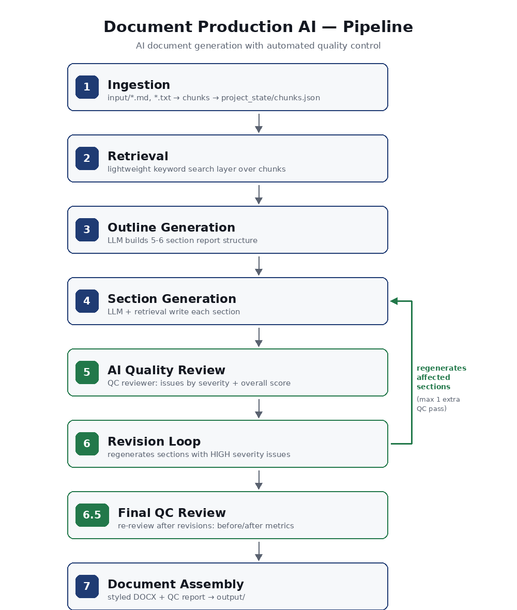
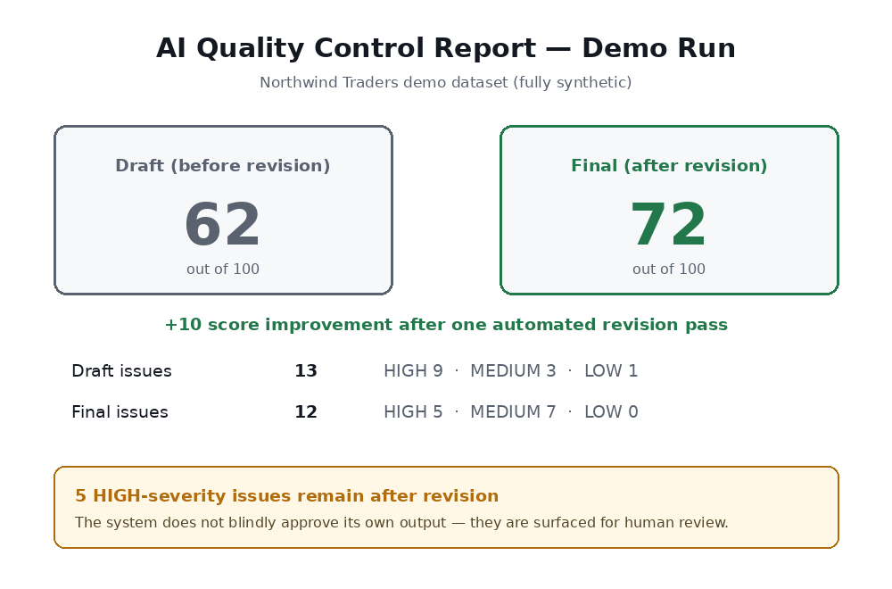
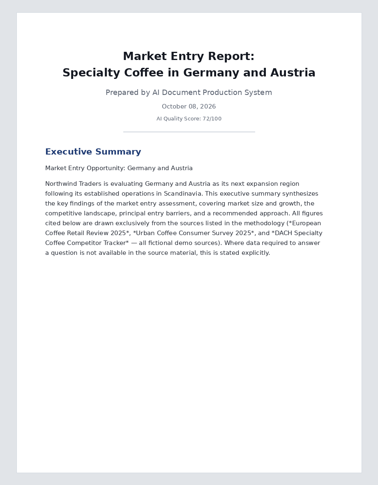
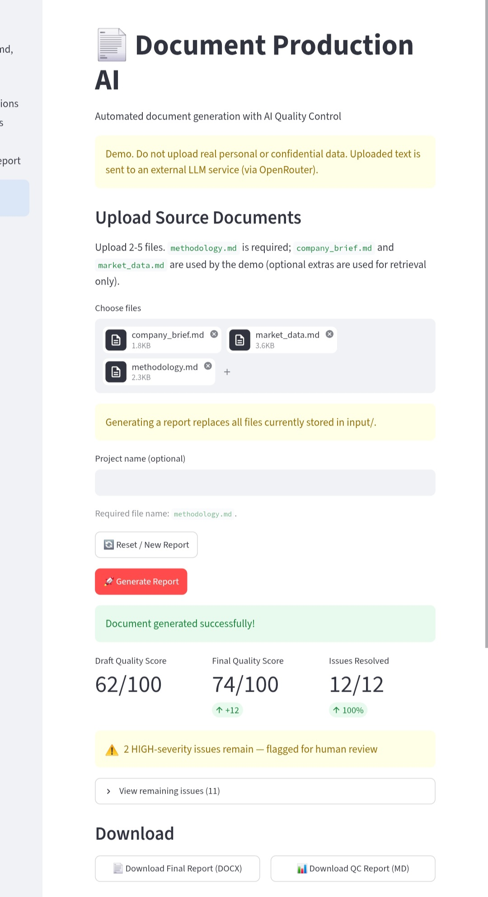
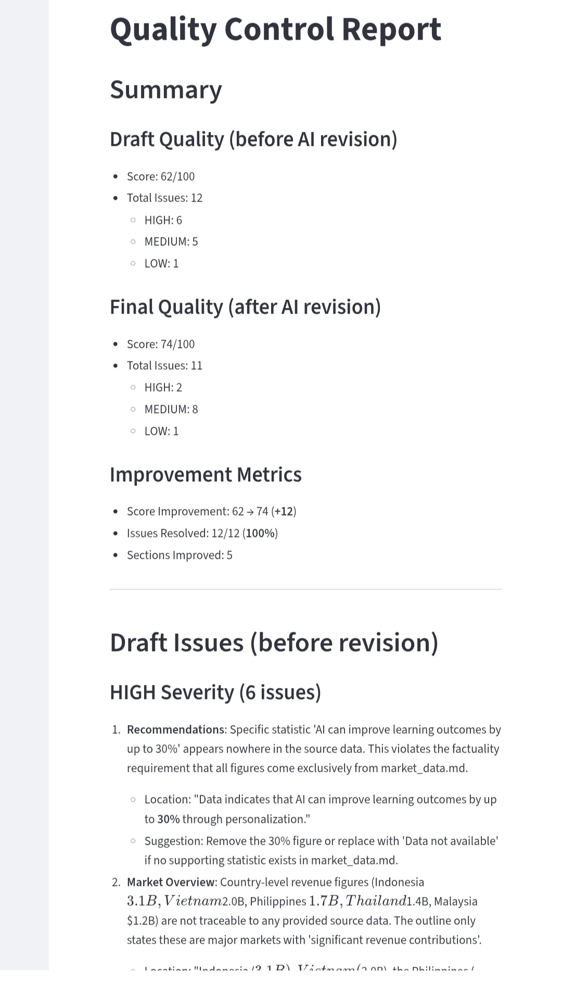

# AI Document Production & Quality Control

[](https://github.com/alex-yorik/document-production-ai/actions/workflows/ci.yml?query=branch%3Amain)


A working prototype that turns source documents into a structured DOCX report —
and then makes the AI critique and improve its own output before delivery.

## Overview

- **Input:** three required markdown files — `company_brief.md`, `market_data.md`, `methodology.md`
- **Output:** styled DOCX report + QC report with before/after metrics
- **Status:** prototype / demo (level D) — not production-ready

## Problem

LLMs generate fluent text but frequently hallucinate: invented figures,
unsupported claims, statements that are not traceable to sources. In business
documents — market reports, briefings — this is a direct credibility risk,
and manual review does not scale.

## Solution

The pipeline pairs a generator with a dedicated QC reviewer. Every section is
checked against the source material. HIGH-severity issues trigger an automated
revision loop. Remaining issues are surfaced for human review — the system
does not blindly approve its own output.

## How It Works

1. **Ingestion** — source documents are chunked and persisted
2. **Retrieval** — lightweight keyword search over chunks
3. **Outline Generation** — LLM builds a 5–6 section report structure
4. **Section Generation** — each section written with LLM + retrieval context
5. **AI Quality Review** — QC reviewer scores sections, reports issues by severity
6. **Revision Loop** — sections with HIGH issues are regenerated (max 1 extra QC pass)
7. **Document Assembly** — styled DOCX + QC report

The system uses two different LLMs: GPT-4o-mini for document generation and
GLM-5.3-Flash for quality control review. This separation avoids self-review
bias and ensures objective quality assessment.

Data flow and storage details: [ARCHITECTURE.md](ARCHITECTURE.md).

## Architecture

```text
Source docs (input/)
        ↓
   1. Ingestion     — chunk & persist
        ↓
   2. Retrieval     — keyword search layer
        ↓
   3. Outline       — LLM builds structure
        ↓
   4. Sections      — LLM + retrieval context
        ↓
   5. QC Review     — severity-scored issues
        ↓
   6. Revision      — regenerate HIGH-issue sections
        ↓
   6.5 Final QC     — before/after metrics
        ↓
   7. Assembly      — output/Final_Report.docx + QC_Report.md
```

```text
run_pipeline.py            # pipeline entry point
app.py                     # optional Streamlit web UI
src/
├── ingestion.py           # chunk source documents
├── retrieval.py           # keyword search layer
├── outline_generator.py   # LLM report structure
├── section_generator.py   # LLM sections with retrieval
├── qc_reviewer.py         # severity-scored issue detection
├── revision_loop.py       # regenerate sections with HIGH issues
├── document_assembler.py  # DOCX + QC report export
├── llm_client.py          # OpenRouter LLM client
├── metrics.py             # resolved-issue metrics
├── upload_utils.py        # upload validation and safe input handling
└── utils.py               # paths, env, JSON helpers
```

## Quality Control

QC has two parts:

1. **LLM reviewer** — checks every section for traceability to the sources,
   unsupported forecasts and derived calculations, and tone/structure. It
   returns issues graded HIGH / MEDIUM / LOW and an overall score (0–100).
   QC uses a DIFFERENT LLM (GLM 5.3 Flash) than the generator (GPT-4o-mini)
   to avoid self-review bias and ensure objective quality control.
2. **Deterministic numeric check** (`_check_numeric_traceability`) — scans every
   numeric token in every section and flags tokens that do not occur in the
   source chunks. These flags are added as HIGH issues marked `(automated check)`.

The reviewer is AI-assisted and does not guarantee the absence of
hallucinations; remaining issues are reported for human review.

### Demo results

> Result of one run on one synthetic dataset, a single sample, not a benchmark.

Latest run (dual-LLM architecture: GPT-4o-mini for generation, GLM-5.3-Flash
for objective QC review):

| Metric        | Draft                        | Final (after revision)       |
| ------------- | ---------------------------- | ---------------------------- |
| Quality score | 62/100                       | 74/100                       |
| Issues        | 12 (6 HIGH, 5 MEDIUM, 1 LOW) | 11 (2 HIGH, 8 MEDIUM, 1 LOW) |

- Score improvement: 62 → 74 (+12)
- Issues resolved: 12/12 (100%)
- Sections improved: 5
- 2 HIGH-severity issues remain, flagged for human review.

Raw output: `demo/expected/QC_Report.md`. See
[docs/reports/portfolio-audit-report.md](docs/reports/portfolio-audit-report.md)
for the audit context.

## Revision Loop

Sections flagged with HIGH-severity issues are regenerated with the issues and
source context injected into the prompt. One extra QC pass runs after revision;
the loop deliberately does not recurse. Remaining HIGH issues are surfaced for
human review, not hidden.

## Output

- `output/Final_Report.docx` — styled report (title page, headings, tables
  rendered as Word tables, bullets, QC score)
- `output/QC_Report.md` — before/after issue comparison with revision actions

## Demo

`demo/` contains a fully synthetic dataset — a fictional company
("Northwind Traders", specialty coffee expansion into Germany and Austria) —
plus `demo/expected/` with the outputs of a real pipeline run. No real client
data is used anywhere in this repository.

`input/` is a second sample dataset (EdTech in Southeast Asia, Russian-language
brief). All companies and figures are fictional; none are real.







## Screenshots

### Main Interface



### QC Report with Metrics



## Tech Stack

- Python 3.12
- OpenRouter (LLM: `openai/gpt-4o-mini` generator, `z-ai/glm-5.3-flash` QC)
- python-docx (DOCX assembly)
- Streamlit (optional web UI)
- python-dotenv

## Project Structure

Full directory tree: [docs/project-structure.md](docs/project-structure.md).
Documentation index: [docs/README.md](docs/README.md).

## Quick Start

```bash
git clone https://github.com/alex-yorik/document-production-ai.git
cd document-production-ai
python3 -m venv .venv
source .venv/bin/activate
pip install -r requirements-prod.txt
cp .env.example .env
```

For tests and linting, install the dev requirements instead:

```bash
pip install -r requirements-dev.txt
```

The pipeline requires exactly these three input files in the input directory:
`company_brief.md`, `market_data.md`, and `methodology.md`. The default
`input/` directory and `demo/input/` both contain them.

## Configuration

Copy `.env.example` to `.env` and set both API keys:

```bash
# Generator: GPT-4o-mini (OpenAI via OpenRouter)
GENERATOR_API_KEY=your_openrouter_api_key_here
GENERATOR_BASE_URL=https://openrouter.ai/api/v1
GENERATOR_MODEL=openai/gpt-4o-mini

# QC Reviewer: GLM 5.3 Flash (Zhipu AI via OpenRouter)
QC_API_KEY=your_openrouter_api_key_here
QC_BASE_URL=https://openrouter.ai/api/v1
QC_MODEL=z-ai/glm-5.3-flash
```

### Dual-LLM Architecture

- **Generator:** GPT-4o-mini (OpenAI via OpenRouter) — outline, sections, revision.
- **QC Reviewer:** GLM 5.3 Flash (Zhipu AI via OpenRouter) — independent review.

Using a different model for QC avoids self-review bias: the generator cannot
quietly approve its own unsupported claims.

`.env` is gitignored and is never committed. Optional settings (endpoint,
model, report title) are documented in `.env.example`. The API key is obtained
at [openrouter.ai/keys](https://openrouter.ai/keys). `LLM_API_KEY` remains a
legacy fallback when the role-specific keys are unset.

To check the API key and connectivity manually, run the smoke script:

```bash
python3 scripts/smoke_llm.py
```

The smoke script is a manual live check and is not part of the offline test suite.

## Running the Demo

```bash
python3 run_pipeline.py
```

or, using the synthetic dataset from `demo/`:

```bash
INPUT_DIR=demo/input REPORT_TITLE="Market Entry Report: Specialty Coffee in Germany and Austria" python3 run_pipeline.py
```

Processing takes ~2–4 minutes (LLM calls). Results are written to
`output/Final_Report.docx` and `output/QC_Report.md`, comparable to
`demo/expected/` (historical outputs, see the note in `demo/README.md`).

The pipeline can be launched from any working directory: state paths are
derived from the repository root.

## Web UI (Optional)

```bash
streamlit run app.py
```

- upload source documents through the browser
- before/after metrics (draft score, final score, resolved issues) in the interface
- download `Final_Report.docx` and `QC_Report.md` with one button

> **WARNING: THE WEB UI OVERWRITES MARKDOWN/TEXT FILES IN `input/` WHEN YOU UPLOAD FILES.**

## Tests & CI

15 test files, 122 test functions; last run: 122 passed, 0 skipped; coverage 92% (packages `src/`, `run_pipeline.py`).

Run offline tests locally with:

```bash
pip install -r requirements-dev.txt
pytest -m "not live" --cov --cov-fail-under=80
```

The suite needs no API keys and no network. The CI workflow runs lint, format
check, tests with the coverage gate, bandit, gitleaks and the modularity check
on every push and pull request.

Required checks on this branch: validate, modularity, security (verified in the
Actions tab on 2026-10-30).

## Limitations

- An issue counts as resolved also when it was rephrased or downgraded in
  severity; there is no semantic verification of the fix.
- Retrieval is a matching-word counter over chunks, not embeddings.
- One LLM provider (OpenRouter) is used; there is no provider fallback.
- There is no authentication and no multi-user support.
- Document quality depends on the quality of the supplied sources.

Full list: [docs/limitations.md](docs/limitations.md).

## Future Improvements

Embeddings-based retrieval, configurable document schemas, PDF export,
human-in-the-loop review — see [docs/roadmap.md](docs/roadmap.md).

## Data & Privacy

Document text and fragments of the source documents are sent to the OpenRouter
API (model `openai/gpt-4o-mini`) for generation and review. Do not upload personal, confidential, or
regulated data. Using real data requires informed consent, a data retention
policy, and a review of the applicable local legislation. No regulatory
compliance is claimed.

`project_state/` and `output/` are local working directories and are gitignored.

## Security

This is a local-use demo: no real data, no authentication. See
[SECURITY.md](SECURITY.md) for the threat model and scan results.

## How this project was built

I am not a professional software developer. This project was built with AI coding assistants ("vibe coding"). I define the product idea, requirements and acceptance criteria, direct the AI tools, run the results, review behavior, and decide what ships. Reviews in this repo are AI-assisted self-reviews, not independent third-party audits.

## License

All rights reserved.

This repository is published as a portfolio demonstration of my work in
AI-assisted document production and quality control.

The code is provided for review and evaluation purposes only.
No commercial use, redistribution, or modification is permitted without
explicit written permission from the author.

For commercial use, licensing discussions, or custom development based
on this architecture — please contact me directly.
